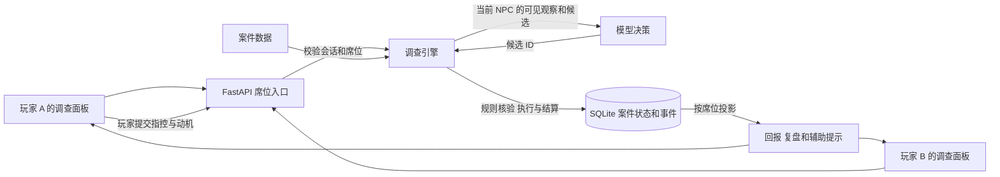

# G03 系统架构与调查视角

游戏以 ScottishFold 的案件库、React 调查面板和 FastAPI 服务为基础。雾港案和宫廷案由同一个行动引擎处理。固定时间线、可核查材料、角色授权和正确结案各由案件数据给出。[上游许可](../LICENSE) · [案件接入](CASE_AUTHORING.md)

## 模块

| 模块 | 职责 |
| --- | --- |
| React 原调查面板 | 保留角色切换、自然语言对话、证物和推理笔记。调查记录入口用来邀请玩家、分享回报、回看进展和获取提示。玩家在原结案流程提交指控。 |
| `api/npc_api.py` | 将会话凭据映射到席位，校验请求参数。把对话、已接受任务恢复、共享、提示、复盘和结案交给服务端。 |
| `api/npc_dialogue.py` | 按角色生成观察和候选。对行动目标、所需材料、权限和世界状态重新核验。执行动作并保存回报、来源和因果关系。按席位生成可见结果，按存档生成复盘。 |
| `api/npc_store.py` | 持久化会话、任务、事件与请求回执。对同局写入加租约保护。外部调用结束后，仅当前租约的持有人可提交状态和回执。 |
| `api/npc_decisions.py` | 解析结构化选择，限制模型调用、超时和重试，记录实际驱动、消耗和错误。规则与固定响应可独立复现。 |
| `api/settings.py`、`api/llm_service.py` | 读取服务端运行配置，调用 `deepseek-flash` 或兼容的配置模型。按运行路径使用结构化选择或普通对话。 |
| `api/npc_cases/` 和剧本库 | 服务端 JSON 提供行动规则和固定真相。React 剧本数据用于公开案情、人物和证物展示。 |

## 服务端入口

| 路径 | 使用方式 |
| --- | --- |
| `GET /npc/cases/{case_id}` | 读取公开角色、受管证物 ID 和结案题目的选项。 |
| `POST /npc/runs`、`POST /npc/invite`、`POST /npc/runs/join` | 主玩家开局并发邀请。来访者通过邀请取得自己的会话凭据。 |
| `POST /npc/dialogue`、`POST /npc/resume` | 选角色发出询问或出示材料。受理后的委托以任务 ID 恢复并结算。 |
| `GET /npc/state`、`GET /npc/room` | 返回本席位的回报、任务、证物和本局公开内容。 |
| `POST /npc/share` | 主动发布当前席位选定的一条调查回报。 |
| `GET /npc/replay`、`POST /npc/assist` | 回看历史可见事件。按玩家显式选择提供线索总结、下一步提示或完整解释。 |
| `POST /npc/verdict` | 提交嫌疑对象与作案动机，交由服务端规则判定。 |

开局和加入返回不同席位的凭据。之后每个请求依据凭据校验身份。请求标识在席位内去重，任务恢复只接受所有者的请求。会话凭据留在各自浏览器中，邀请链接用于新增席位。

## 一条调查如何完成

玩家请宋屿查昨晚西门的进入记录。引擎先根据宋屿的角色状态提供可选意图和动作。模型可以提议合法动作、拒绝或等待。接受时，服务器先保存任务和玩家可见的受理信息。恢复该任务时，程序再次检查权限。获准联系后，阮岑在自己的视角内决定是否作答。营造叙事的台词与候选选择不改变案情记录。

结算事件包含实际记录时间、来源、父事件、发出者和可见范围。故事里的案发或入库时刻存于材料和固定时间线。如果阮岑透露了口供，玩家拿到的回报会指明信息来自阮岑。玩家可以去找他确认来访情况或直接询问目击内容。模型故障由已配置的规则处置，事实和权限仍从同一份案件数据读取。

已接受任务与结算的回执保存在 SQLite。浏览器重试或服务重启后，恢复依据已保存的任务和请求身份。玩家继续收到同一份回报。受理后的委托须在 15 分钟内恢复。每席位最多同时受理 3 项待办，同一席位的累计委托成本上限为 30。角色间的问答由有限的行动链结算，全局自动反应共享 20 点预算。

## 权限与知识的边界

| 信息 | 保有者与用途 |
| --- | --- |
| 固定真相和时间线 | 服务端案情数据用来判定指控和动机。玩家明确请求完整解释后按游戏的结案流程披露。 |
| 已核查的记录 | 原件、日志、工单等可用对象。只有授权行动才能核查，可信度来自对象在案情配置中的属性。 |
| 主张和角色亲历 | 包括门卫记下的时间、他对衣物的观察、经其他角色转述的私下消息。以有来源的陈述保存。 |
| 玩家持有的证物 | 每席位独立查看。初始证物由案情配置授予，隐藏证物由成功调查授予。客户端出示证物时，持有权由服务器核对。 |
| 关系和信任 | 角色当前的判断依据。采信、怀疑和隐瞒影响行为及披露范围。 |
| 私下行动与角色记忆 | 模型只得到当前决策角色可见的观察。联络内容按参与者保存，许可转述以新的事件发生。 |
| 玩家回报、笔记与共享内容 | 任务和回报按席位保存。原界面笔记供当前席位使用。玩家显式公开选中的回报后，其他席位可从该发布时刻读取。 |

复盘直接读取已保存的事件。每个节点标出当时可见的来源和范围，玩家主动展开时才显示事后的结案解释。超出视角范围的父事件从投影中省略。线索总结按当前席位能查看的口述与核查材料整理，并标出能互相对照的主题。下一步提示从已知主题整理的候选中选择，故事里与玩家合作的 NPC 仍使用同一个角色引擎。

## 模型配置与运行边界

DeepSeek 游戏运行时通过服务端的 `INFERENCE_SERVICE=deepseek`、`DEEPSEEK_BASE_URL=https://api.deepseek.com`、`DEEPSEEK_MODEL=deepseek-flash` 和 `DEEPSEEK_API_KEY` 配置。官方 API 模型 ID 为 `deepseek-flash`，服务版本为 DeepSeek-V4.1-Flash-1017。`NPC_DECISION_MODE=llm` 启用真实候选选择。模型密钥留在服务端。候选选择使用非思考模式和只含候选 ID 的 JSON，程序校验结构与行动许可。[DeepSeek 模型与价格](https://api-docs.deepseek.com/quick_start/pricing/)

决策请求有 5 秒总时限、最多一次符合条件的重试，以及每次交互最多三次外部请求。单次输出限制为 96 token。每局预算上限为 120 次请求、20 万输入 token 和 1.2 万输出 token，覆盖结构化调查决策和下一步提示。原普通流式对话沿用独立的请求超时与输出限制。记录保存调用模式、结果、使用量、耗时和用于关联请求的摘要。评测分别统计 Mock、Rules、真实调用及回退。[验收与复现](../ACCEPTANCE.md)

## 已知边界

- 同局调查在主玩家之外最多预留三个访客席位。身份来自持有各自的会话凭据。运行前先确认参与者的浏览器都能访问同一服务。
- API 的席位视角适用于游玩和课堂演示。仓库作者可查看服务端 JSON 内的结案信息。修改案情时，用新会话和相应版本的评测记录核对影响。
- 上游依赖、浏览器构建信息、真实模型和自动模拟的实测结果随验收记录更新。[验收范围](../ACCEPTANCE.md)
- 自主循环是按事件启动的有限行动。空间模拟、2D/3D 场景、Unity 移植和复杂联网平台留在后续范围。[主任务](https://github.com/bingc11/g03-dynamic-mystery/issues/4)

后续增加案件时，可先用本指南的样例验明线索可达、结案可复现，再加入能暴露角色边界的对照情境。课堂试用可专门记录同学在哪一步需要提示、哪项记录最能支持指控，以便修改提示和证物内容。[案件接入](CASE_AUTHORING.md) · [课堂脚本](CLASSROOM.md)
